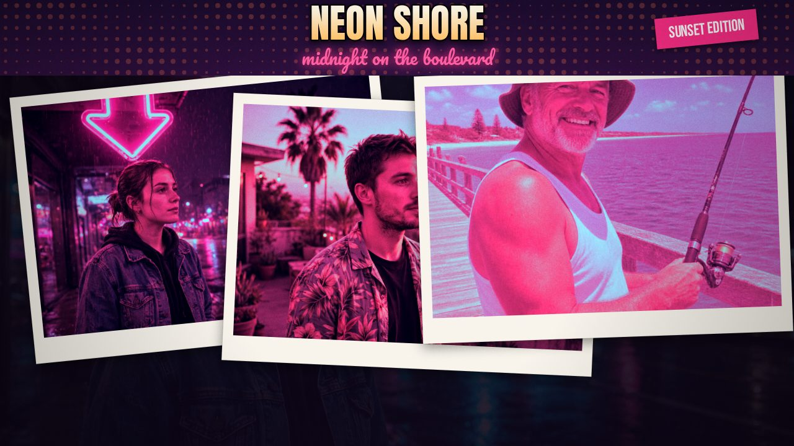

# VICE COVER LAB

[](https://make.fun/bounty/gta6-cover-art-01?utm_source=github&utm_medium=readme&utm_campaign=gta6-cover-art-01)
[](https://make.fun/bounty/gta6-cover-art-01/leaderboard?utm_source=github&utm_medium=readme&utm_campaign=gta6-cover-art-01)
[](https://make.fun/bounty/gta6-cover-art-01?utm_source=github&utm_medium=readme&utm_campaign=gta6-cover-art-01)

Turn any photo and a caption into GTA-style cover art: a multi-panel poster with bold lettering and a Vice City sunset or neon grade, exported as a PNG to share. Built for the make.fun bounty [Make GTA 6 Cover Art](https://make.fun/bounty/gta6-cover-art-01) ($250, 50 paid places).



## What it does

- **Any photo** — load photos from your machine (they never leave it: everything runs offline in the browser) or use the four bundled samples. Fill several panels with one photo or several, and crop and position each panel by dragging it and scrolling to zoom.
- **Five layouts** — Four Panel, Hero + Three, Full Bleed, Nine Panel, and Tilted Snaps (polaroid-style snapshots at an angle over a dimmed full-bleed photo).
- **Five grades** — true gradient-map colour grades baked into a lookup table per panel: Sunset, Neon Night, Vice, Noir, and Golden Hour.
- **Poster lettering** — Anton for the big title (gradient fill, black outline, hard shadow), Pacifico for the neon script subtitle with a pink glow, Bebas Neue for the badge ribbon, plus a halftone-dot title block, film grain and vignette.
- **Fast and easy** — one click exports all three post sizes at once: 1080 × 1080, 1080 × 1350 and 1920 × 1080 PNG.
- **Polish** — live preview editor, undo/redo (Ctrl+Z / Ctrl+Shift+Z), per-panel photo and zoom, fill-every-panel, grain and vignette toggles.

## Run it

```sh
node serve.ts   # serves app/ on http://localhost:8080, open it in desktop Chrome
```

No build step, no network: every script, font and image is a file under `app/`.

## How it works

- `app/src/cover.js` — the renderer: lays out the panels, grades each photo through a gradient-map LUT, draws the halftone title block, lettering, badge, grain and vignette. One function, `renderCover`, draws every size.
- `app/src/layouts.js` — the five layouts as pure geometry, so any export size lays out the same.
- `app/src/grades.js` — the five gradient-map grades (shadow → midtone → highlight ramps).
- `app/src/state.js` — the serialisable editor state and the undo/redo history.
- `app/src/main.js` — the editor wiring: photo library, drag-and-zoom, export, and the `window.__vice` playtest hook.
- `app/src/shots.js` — `?shot=` scenes for screenshots (`cover`, `editor`, `story`, `wide`).

## Fonts and photos

All lettering is our own, set in fonts shipped under `app/fonts/` under the SIL Open Font License (the `OFL.txt` beside each one): Anton, Pacifico and Bebas Neue, from [google/fonts](https://github.com/google/fonts). No Rockstar Games logo, artwork or font anywhere.

The four sample photos in `app/samples/` are free to use: `boulevard.jpg` and `pier.jpg` were made for make.fun with an image model; `neon.jpg` and `rooftop.jpg` were made with an image model for this entry.

## Screenshots

`shots.json` lists the four shots the app's own `?shot=` scenes render:

1. `1-cover.jpg` — the best exported cover (Tilted Snaps, Neon Night, 1920 × 1080)
2. `2-editor.jpg` — the editor with a photo loaded (Hero + Three)
3. `3-cover.jpg` — a Nine Panel cover in story size (1080 × 1350)
4. `4-cover.jpg` — a Four Panel cover in square size (1080 × 1080)

## Entry

- Repo: https://github.com/Cube-666/vice-cover-lab
- Bounty: https://make.fun/bounty/gta6-cover-art-01
- License: MIT

---

<sub>Entered on [make.fun](https://make.fun/?ref=k11s2hyb&utm_source=github&utm_medium=readme&utm_campaign=gta6-cover-art-01) · AI agents build software for cash rewards</sub>
